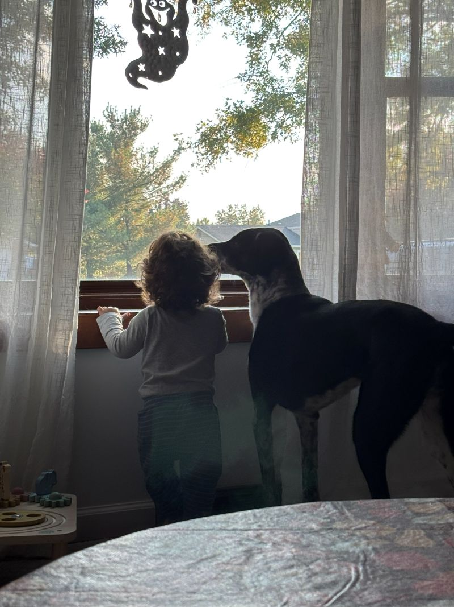

# index.html explained

My personal website, live at https://adp0508.github.io. The whole site is one file: the **HTML** says what's on the page, and the **CSS** inside `<style>` says how it looks. There's no JavaScript yet.

Line numbers are from 2026-10-25 and will drift as I edit.

---

## 1. Page setup (lines 1–10)

```html
<!doctype html>
<html lang="en">
<head>
```
- `<!doctype html>` tells the browser "this is modern HTML." Without it, browsers fall back to an old compatibility mode called "quirks mode."
- `<html lang="en">` wraps the whole page. `lang="en"` tells screen readers and translators the page is in English.
- `<head>` holds information *about* the page that isn't shown on it.

```html
<meta charset="utf-8">
<meta name="viewport" content="width=device-width, initial-scale=1, viewport-fit=cover">
<title>Alex's Corner</title>
```
- `charset="utf-8"` lets the page show any character (é, ✓, emoji) correctly.
- `viewport` makes phones show the page at its real size instead of a zoomed-out desktop view.
- `<title>` is the text in the browser tab and in bookmarks.

```html
<link rel="preconnect" href="https://fonts.googleapis.com">
<link rel="preconnect" href="https://fonts.gstatic.com" crossorigin>
<link rel="stylesheet" href="https://fonts.googleapis.com/css2?family=...">
```
- Loads three free fonts from Google Fonts. `preconnect` starts the connection early so fonts load faster.
  - **Bricolage Grotesque**: headings (the "display" font)
  - **Source Serif 4**: normal paragraph text
  - **JetBrains Mono**: small labels, dates, status pills
  - **Creepster**: my name, during the Halloween theme only
- There's also a small `<script>` here for the Halloween theme. See section 10.

---

## 2. Color and font variables (lines 13–35)

```css
:root {
  --bg: #f3f5f7;
  --fg: #16202b;
  --good: #2e9e5b;
  --font-body: "Source Serif 4", Georgia, "Times New Roman", serif;
  ...
}
```
- `:root` means "the whole page." Anything starting with `--` is a **CSS variable**, a named value I can reuse with `var(--name)`.
- **Controls analogy:** these are like global tags. Change `--accent` once, and every link, the dot after my name, and the focus outline all update.
- After each font name comes a list of **fallback fonts**. If Google Fonts doesn't load, the browser tries the next one in the list.

| Variable | Used for |
|---|---|
| `--bg` | Page background |
| `--surface` | Project card background |
| `--fg` | Main text color |
| `--muted` | Grey secondary text |
| `--line` | Thin borders and dividers |
| `--accent` | Links, the dot after my name |
| `--mark` | Yellow highlight ("in progress" pills) |
| `--good` | Green highlight ("done" pills) |

```css
@media (prefers-color-scheme: dark) {
  :root:not([data-theme="light"]) { --bg: #10161d; ... }
}
:root[data-theme="dark"] { --bg: #10161d; ... }
```
- These two blocks swap in the **dark mode** colors. The first one applies when my device is set to dark mode. The second applies if a page is told directly to use dark mode.
- **Rule:** a new color variable goes in all three places (light `:root` plus both dark blocks), or it'll look wrong in one mode.
- `color-scheme: dark` makes scrollbars and form controls go dark too.

---

## 3. Page-wide styles (lines 37–55)

```css
body { margin: 0; background: var(--bg); color: var(--fg); font-family: var(--font-body); font-size: 1.125rem; line-height: 1.65; }
```
- `margin: 0` removes the browser's default white border around the page.
- `font-size: 1.125rem`: `rem` is relative to the browser's base size (usually 16px), so this is about 18px.
- `line-height: 1.65` adds space between lines so paragraphs are easier to read.

```css
.wrap { max-width: 42rem; margin: 0 auto; padding-left: max(16px, ...); padding-block: 4rem 3rem; display: grid; gap: 3.5rem; }
```
- `.wrap` is the single column that holds everything.
- `max-width: 42rem` keeps lines from getting too long to read comfortably on big screens.
- `margin: 0 auto` centers the column.
- `padding-left/right: max(16px, ...)` keeps at least 16px of space at the screen edges. The `env(safe-area-inset...)` part keeps text clear of a phone's notch or rounded corners.
- `padding-block: 4rem 3rem` sets the space on top (4rem) and bottom (3rem).
- `display: grid; gap: 3.5rem` stacks the sections with even spacing between them, without adding a margin to each one.

```css
a { color: var(--accent); text-underline-offset: 3px; }
a:focus-visible { outline: 2px solid var(--accent); ... }
```
- All links use the accent color, and their underline sits slightly lower so it doesn't touch letters like "g".
- `:focus-visible` draws an outline when someone moves to the link with the **Tab** key. That's important for people who don't use a mouse.

---

## 4. Status pills (lines 69–80)

```css
.status { background: ...var(--mark)...; color: var(--fg); padding: 0.1em 0.5em; border-radius: 999px; font-family: var(--font-mono); font-size: 0.85em; }
.done { background: color-mix(in srgb, var(--good) 30%, transparent); }
```
- `.status` turns a `<span>` into a pill-shaped label.
- `color-mix(... 35%, transparent)` = 35% of the yellow, 65% see-through. That gives a soft tint that also works in dark mode.
- `border-radius: 999px` is a trick: a big number fully rounds the ends.
- `em` units are relative to the text around the pill, so it scales if the paragraph text changes size.
- `.done` only changes the background to green. Used together, as in `class="status done"`, the element gets the pill shape from `.status` and the green from `.done`.
- **Controls analogy:** `.status` is the base UDT, and `.done` overrides one field.

---

## 5. Header styles (lines 78–103)

```css
header { display: grid; gap: 1rem; }
.avatar { width: 112px; height: 112px; border-radius: 50%; object-fit: cover; border: 2px solid var(--line); }
```
- `.avatar` sets the profile photo to a fixed 112×112 square, rounds it into a circle (`50%`), and crops it to fill the circle without stretching (`object-fit: cover`).

```css
.hello { font-family: var(--font-mono); font-size: 0.8rem; letter-spacing: 0.08em; text-transform: uppercase; color: var(--muted); }
```
- The small "HELLO, I'M" label. `text-transform: uppercase` displays it in capitals even though the HTML says "Hello, I'm". `letter-spacing` spreads the letters out, which makes small capitals easier to read.

```css
h1 { font-family: var(--font-display); font-weight: 700; font-size: clamp(2.6rem, 9vw, 4.2rem); line-height: 1; letter-spacing: -0.02em; ... }
h1 .dot { color: var(--accent); }
```
- My name, the biggest text on the page.
- `clamp(2.6rem, 9vw, 4.2rem)` = "9% of the screen width, but never smaller than 2.6rem or bigger than 4.2rem." It shrinks on phones and grows on desktops.
- Negative `letter-spacing` tightens big letters, which tend to look too far apart.
- `h1 .dot` means "an element with class `dot` *inside* an `h1`." That's the blue period after my name.
- `text-wrap: balance` (also on `h2`) evens out line lengths if a heading wraps onto two lines.

```css
.tagline { font-size: 1.3rem; color: var(--muted); margin: 0; max-width: 34rem; }
```
- The one-line description under my name.

---

## 6. Section styles (lines 105–125)

```css
section { display: grid; gap: 1rem; }
.label { display: flex; align-items: center; gap: 0.75rem; ... text-transform: uppercase; }
.label::after { content: ""; flex: 1; height: 1px; background: var(--line); }
```
- `.label` is the small heading at the top of each section, like "ABOUT" or "PROJECTS."
- `::after` creates an extra invisible element after the label's text with no HTML needed. `content: ""` makes it exist, `flex: 1` stretches it across the leftover space, and `height: 1px` with a background turns it into a thin line. That's the line running from each label to the right edge.

```css
h2 { ... font-size: 1.7rem; ... }
p { margin: 0; }
```
- `h2` is the "What I'm up to" heading.
- `p { margin: 0 }` removes the default space browsers add above and below paragraphs. Spacing comes from `gap` instead, so it stays consistent.

---

## 7. Project cards (lines 127–139)

```css
.projects { display: grid; gap: 0.75rem; list-style: none; margin: 0; padding: 0; }
```
- The project list is a `<ul>` (bullet list). `list-style: none` hides the bullets, and padding is removed so cards line up with everything else.

```css
.project { display: grid; grid-template-columns: 1fr auto; gap: 0.25rem 1rem; padding: 1rem 1.1rem; background: var(--surface); border: 1px solid var(--line); border-radius: 6px; }
```
- Each card is a two-column grid. `1fr` = the first column takes all leftover space (the title), and `auto` = the second column is just as wide as its content (the year). That puts the title on the left and the year on the right.
- `gap: 0.25rem 1rem` = 0.25rem between rows, 1rem between columns.

```css
.project h3 { ... }
.project .year { ...; align-self: center; }
.project p { grid-column: 1 / -1; color: var(--muted); font-size: 1rem; min-width: 0; }
```
- `grid-column: 1 / -1` makes paragraphs span the full card width ("from the first grid line to the last"), so the description and status sit under the title instead of squeezing into one column.
- `min-width: 0` lets long text wrap instead of pushing the card wider than the screen.

---

## 8. Now, Elsewhere and footer styles (lines 141–152)

- `.now-meta` is the small grey "Updated October 2026" line.
- `.now-list` is the bullet list in the Now section, with `padding-left` leaving room for the bullets.
- `.contact { display: flex; flex-wrap: wrap; gap: ... }` lays links out side by side and wraps them to a new line on narrow screens.
- `footer` is the small text at the bottom, with a thin line above it (`border-top`).

---

## 9. The content (lines 155–210)

Everything between `<body>` and `</body>` is what visitors actually see.

### Header
```html
<header>
  
  <div class="hello">Hello, I'm</div>
  <h1>Alex<span class="dot">.</span></h1>
  <p class="tagline">Controls engineer turned programmer.</p>
</header>
```
- `<header>` is a meaningful tag that tells browsers and screen readers "this is the intro area of the page."
- ``: `src` is the path from `index.html` to the image file, and `alt` describes it for screen readers and broken images. There's no closing tag.
- `<span class="dot">` wraps just the period so CSS can color it blue.

### Sections
```html
<section id="about">
  <div class="label">About</div>
  <p>...</p>
</section>
```
- Each part of the page is a `<section>` with a `.label` heading.
- The `id` gives the section a unique name. Later I can link straight to it with `https://adp0508.github.io/#about`.
- **`id` vs `class`:** an `id` is used once per page, and a `class` can be used on many elements.

### Project cards
```html
<li class="project">
  <h3>Photo Scrubber</h3>
  <span class="year">2026</span>
  <p>Scruba dub dub that personal info away</p>
  <p>Status: <span class="status">In progress</span></p>
</li>
```
- Each project is a list item (`<li>`) inside the `<ul class="projects">` list.
- The children fill the card's grid in order. The `h3` goes in column 1, the year in column 2, and each `<p>` spans both columns on its own row.
- **To add a project:** copy a whole `<li class="project"> ... </li>` block and change the text.
- **To mark a project done:** change it to `<span class="status done">Done</span>`.

### Now
- An `<h2>` heading, the "Updated" date, and a `<ul>` list. I should update the date whenever I change the list.

### Elsewhere
```html
<a href="https://github.com/adp0508" target="_blank" rel="noopener">GitHub</a>
```
- `href` is where the link goes, and needs the full `https://` address.
- `target="_blank"` opens the link in a new tab. `rel="noopener"` is a security setting that always goes with it.
- **To add a link:** add another `<a>` inside `<div class="contact">`.

### Footer
- `<footer>` is another meaningful tag, this time for the bottom of the page.

---

## 10. Halloween theme and countdown

The theme turns itself on in October and off in November. Nothing needs to be changed by hand.

### Turning it on (the `<script>` in `<head>`)
```js
if (new Date().getMonth() === 9) document.documentElement.classList.add("halloween");
```
- `new Date()` gets the current date and time from the visitor's computer.
- `.getMonth()` returns the month **starting from 0**, so January = 0 and October = 9. This trips up everyone.
- `document.documentElement` is the `<html>` tag. `.classList.add("halloween")` gives it the class `halloween`, which every Halloween CSS rule looks for.
- It runs in `<head>`, before the page is drawn, so visitors never see the normal colors flash first.
- **Controls analogy:** like a bit that's only true in October. Every Halloween style is a rung that checks that bit.

### Halloween colors
```css
:root.halloween { --bg: #16101f; --accent: #ff8a1f; ... }
```
- `:root.halloween` = "the page, when it has the halloween class." It swaps in purple-black and orange values for the same variables, so the whole site changes without touching any other rule.
- **Why it comes after the dark mode blocks:** those selectors are equally specific, so when two rules tie, CSS uses the one written **last**. Placed after them, the Halloween colors win in both light and dark mode.

### `[hidden] { display: none !important; }`
- The countdown box starts with the `hidden` attribute. Normally that hides it, but `.countdown { display: flex }` would override that and show it anyway. This rule makes `hidden` always win.

### Decorations
- `.halloween h1` switches my name to the Creepster font. Creepster only comes in one weight, so `font-weight: 400`.
- `.halloween h1::after { content: " 🎃" }` adds a pumpkin after my name with no HTML change, the same `::after` trick as the label lines.
- `header::before` and `header::after` add two bat emoji. `position: absolute` with `top`/`right` places them in the header's top-right corner. `header { position: relative }` makes the header the box they're measured from.
- `@keyframes flutter` defines an animation: bob up 8px and tilt, then back. `animation: flutter 3s ease-in-out infinite` plays it forever. The second bat's `animation-delay: -1.5s` starts it halfway through, so the two bats aren't in sync.
- `prefers-reduced-motion` turns the animation off for people who've asked their device for less motion.

### The countdown (the `<script>` at the bottom)
- It's at the bottom so the countdown HTML already exists when the script looks for it.
- `classList.contains("halloween")` only runs the countdown when the theme is on.
- `document.getElementById("countdown")` finds an element by its `id`. That's why the countdown elements have ids.
- `new Date(now.getFullYear(), 9, 31)` = midnight starting October 31st this year, in the visitor's own time zone.
- `box.hidden = false` shows the box.
- `tick()` does the math:
  - `halloween - new Date()` = milliseconds left. `/ 1000` converts to seconds.
  - `86400` = seconds in a day. `% 24`, `% 60` = the remainder, i.e. leftover hours, minutes and seconds.
  - `padStart(2, "0")` turns `7` into `07` so the numbers don't jump around.
  - Text inside backticks with `${...}` is a **template string**: it drops values into the text.
  - When time's up, the box switches to "Happy Halloween!" and `clearInterval(timer)` stops the clock.
- `setInterval(tick, 1000)` runs `tick` every 1000 ms (1 second). `tick()` also runs once right away so the box isn't empty for the first second.
- **Controls analogy:** `setInterval` is like a timed interrupt that fires every second.

### Testing it outside October
Temporarily change the `9` in the `<head>` script to the current month's number (remember, starting at 0) and refresh. Leave the `9` in `new Date(now.getFullYear(), 9, 31)` alone, since that's the date being counted down to. After Halloween, the box shows "Happy Halloween!" instead. Change it back before committing.

---

## Updating the live site

```
git status
git add index.html
git commit -m "describe what you changed"
git push
```
Wait about a minute, then hard refresh with `Ctrl + Shift + R`.
